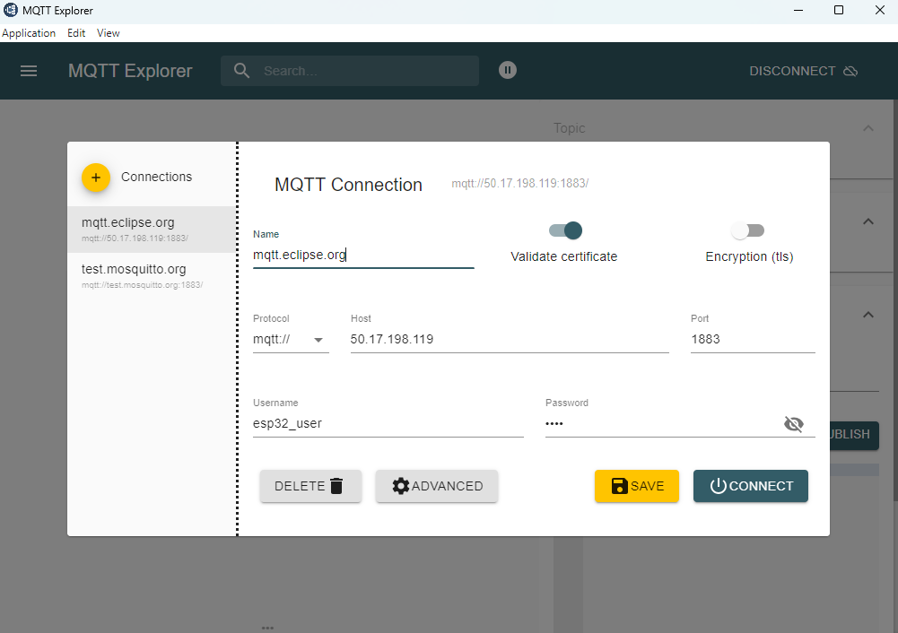
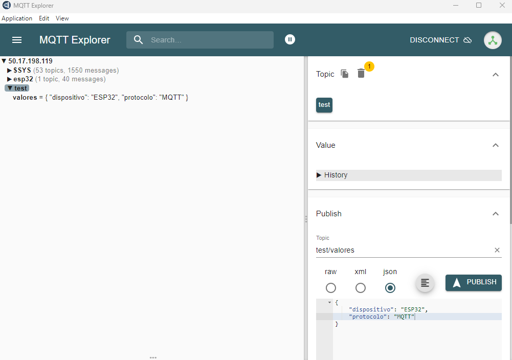
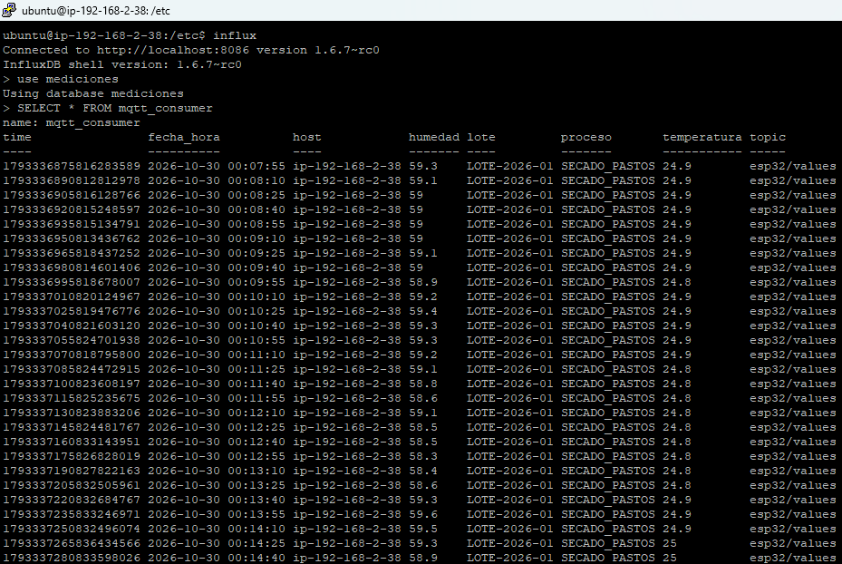
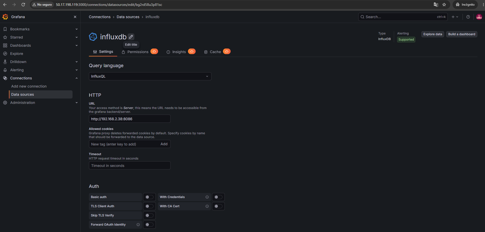
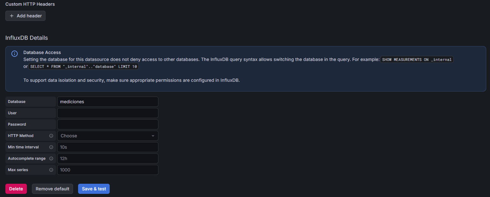

# broker-mqtt-iot

Control de variables críticas (temperatura y humedad) en las etapas de secado y almacenamiento de bioproductos de hoja de coca. Integra captura con ESP32, telemetría vía MQTT, procesamiento de series temporales mediante Telegraf e InfluxDB, y visualización con alertas instantáneas de baja latencia usando Grafana y Telegram

## Integrantes
* Valentina Arciniegas
* Davinson Tulande
* Carlos Daza
* Andres Coral

## Reglas de Seguridad en AWS (Security Groups)

| Instancia | Puerto | Protocolo | Origen / Source | Propósito |
| :--- | :--- | :--- | :--- | :--- |
| **Instancia 1 (Pública)** | `22` | TCP | `Mi IP` | Acceso SSH Administrativo |
| | `1883` | TCP | `0.0.0.0/0` | Ingesta de datos desde el ESP32 (MQTT) |
| | `3000` | TCP | `0.0.0.0/0` | Acceso Web al Dashboard de Grafana |
| **Instancia 2 (Privada)** | `22` | TCP | `IP_PRIVADA_INSTANCIA_1` | Acceso SSH mediante Bastion Host / Jump Server |
| | `8086` | TCP | `IP_PRIVADA_INSTANCIA_1` | Escritura (Telegraf) y Consulta (Grafana) |

## 1. Configuración de Mosquitto 

Mosquitto es un intermediario de mensajes (message broker) de código abierto, ligero y de alto rendimiento que implementa el protocolo MQTT (Message Queuing Telemetry Transport).

### Requisitos Previos

Asegurarse de tener habilitado el puerto correspondiente en las reglas del Security Group de AWS y en el firewall del servidor en red publica. Para este caso se habilita el puerto `1883`.

### Instalación

En la instancia publica se debe instalar el servidor de Mosquitto junto con las utilidades de cliente para realizar pruebas directas:

```bash
sudo apt update
sudo apt install -y mosquitto mosquitto-clients
```

### Gestión de Usuarios y Autenticación

Para proteger el bróker y evitar accesos no autorizados se crean  credenciales específicas para la ESP32 

```bash
sudo mosquitto_passwd -c /etc/mosquitto/passwd USUARIO
```
Se crea un usuario `esp32_user` con contraseña.

### Archivo de Configuración 

se debe editar el archivo principal de configuración de Mosquitto  para habilitar la interfaz de red y la autenticación por contraseña:

```bash
# Place your local configuration in /etc/mosquitto/conf.d/
# A full description of the configuration file is at
# /usr/share/doc/mosquitto/examples/mosquitto.conf

#pid_file /run/mosquitto/mosquitto.pid

persistence true
persistence_location /var/lib/mosquitto/

listener 1883 0.0.0.0
allow_anonymous false
password_file /etc/mosquitto/passwd

log_dest file /var/log/mosquitto/mosquitto.log

include_dir /etc/mosquitto/conf.d

```
### Control del Servicio

Se aplica los cambios reiniciando el servicio de Mosquito `/etc/mosquitto/mosquitto.conf` y configurar para que inicie automáticamente junto con el servidor:

```bash
# Habilitar e iniciar el servicio
sudo systemctl enable mosquitto
sudo systemctl restart mosquitto

# Comprobar estado del servicio
sudo systemctl status mosquitto
```
### Verificación con Mqtt Explorer

Se debe descargar MQTT Explorer, al abrir la aplicación se debe configurar la conexión de la siguiente manera:



una vez se realice la conexión se puede realizar un envio MQTT de la siguiente manera:



## 2. Configuración de ESP32

El microcontrolador ESP32 está programado en C++ usando el framework de Arduino. Su función principal es leer los datos del sensor de temperatura y humedad (DHT11), sincronizar la hora local mediante un servidor NTP y enviar las mediciones periódicamente al servidor mediante el protocolo MQTT.

Sensor: DHT11 (Medición de temperatura y humedad ambiental).

Conexiones:

* DHTPIN: Data conectada al GPIO 19.
* VCC: 3.3V / 5V.
* GND: Tierra común.

### Archivo de Configuración (`config.h`)

El proyecto utiliza un archivo de cabecera centralizado (`config.h`) para gestionar las credenciales de red, dirección IP del servidor MQTT, parámetros de trazabilidad y configuración del hardware:

```bash
// --- Configuración de Red WiFi ---
#define WIFI_SSID     "NOMBRE RED WIFI 2.4"
#define WIFI_PASSWORD "CLAVE"

// --- Configuración del Broker MQTT ---
const char* mqtt_server = "18.209.235.164"; // Dirección IP de la instancia EC2
const int mqtt_port     = 1883;             // Puerto estándar de Mosquitto
const char* mqtt_user   = "esp32_user";     // Usuario autenticado
const char* mqtt_pass   = "****";           // Contraseña del usuario

// --- Metadatos de Trazabilidad y Proceso ---
#define SENSOR_ID     "ESP32"
#define LOTE          "LOTE-2026-01"
#define PROCESO       "SECADO_PASTOS"

// --- Configuración del Hardware ---
#define DHTPIN        19         // Pin GPIO19 conectado a la línea Data del sensor
#define DHTTYPE       DHT11      // Modelo del sensor de temperatura/humedad

#endif
```
### Lógica del Firmware y Publicación

* Se inicia el sensor DHT11
* Establece conexión a la red WiFi mediante las credenciales almacenadas.
* Para asegurar la validez de los datos de trazabilidad, el ESP32 obtiene la fecha y hora precisa desde la red antes de publicar cualquier métrica.
* Asigna los parámetros de conexión al cliente MQTT (PubSubClient)
* Evalúa constantemente la conexión al broker. Si la sesión cae, activa la rutina `reconnect()` que reintenta la autenticación cada 5 segundos.
* Utiliza `millis()` para muestrear y enviar datos cada 15 segundos `(interval = 15000)`, evitando el uso de llamadas `delay()` que detengan la ejecución.
* Lee la temperatura (°C) y la humedad (%). Si la lectura falla o arroja un valor no válido `(isnan)`, aborta el envío para evitar registrar datos corruptos.
* Envia los datos en Formato JSON de la siguiente manera:
  
```bash
{
  "id_sensor": "ESP32",
  "temperatura": 22.4,
  "humedad": 65.0,
  "lote": "LOTE-2026-01",
  "proceso": "SECADO_PASTOS",
  "fecha_hora": "2026-10-30 21:45:00"
}
```
publica el tópico `esp32/values`.

## 3. Prueba de conectividad MQTT -ESP32

Para verificar que el broker Mosquitto  en el servidor EC2 está recibiendo correctamente las métricas enviadas por el ESP32,se puede suscribir en tiempo real al tópico mediante la herramienta CLI de Mosquitto.

```bash
mosquitto_sub -h localhost -p 1883 -u "esp32_user" -P "1234" -t "esp32/values" -v
```

### Guardar CSV

se puede guardar el csv de la siguiente manera:

```bash
mosquitto_sub -h localhost -p 1883 -u "esp32_user" -P "1234" -t "esp32/values" >nombre_base_de_datos.csv
```

## 4.Configuración de InfluxDB

Para que la telemetría enviada por la ESP32 a través de MQTT pueda ser almacenada y consultada en tiempo real por Grafana, se utiliza InfluxDB como motor de base de datos especializado en series temporales. Se debe hacer la instalación en la red privada ya que se enfoca hacia la seguridad, la eficiencia y las buenas prácticas de arquitectura. 

### Requisitos Previos

Se debe realizar la conexión a la segunda instancia que esta en una red privada por medio de la primera instancia, esta permite recibir las conexiones SSH autorizadas desde el exterior (red pública) y reenviarlas de forma segura hacia la interfaz de red privada  de la segunda instancia, evitando exponer esta última directamente a Internet.

Asegurarse de tener habilitado el puerto correspondiente en las reglas del Security Group de AWS y en el firewall del servidor en red publica. Para este caso se habilita el puerto `8086` permitido únicamente desde la IP Privada de la Instancia 1.

```bash
# Actualizar repositorios e instalar dependencias básicas
apt-get update && apt-get install -y curl gnupg2

# Agregar la clave GPG oficial de InfluxData
wget -q https://repos.influxdata.com/influxdata-archive_compat.key
echo "39392622605745636582954638e33d4576d87a3e0c0073cd05943a7366367565 influxdata-archive_compat.key" | sha256sum -c && cat influxdata-archive_compat.key | gpg --dearmor | tee /etc/apt/trusted.gpg.d/influxdata-archive_compat.gpg > /dev/null

#  Agregar el repositorio a las fuentes de APT
echo 'deb [signed-by=/etc/apt/trusted.gpg.d/influxdata-archive_compat.gpg] https://repos.influxdata.com/debian stable main' | tee /etc/apt/sources.list.d/influxdata.list

# Instalar únicamente el paquete InfluxDB (incluye motor y CLI 'influx')
apt-get update && apt-get install -y influxdb
```
### Control del Servicio

Habilitar InfluxDB para que se ejecute automáticamente cada vez que la instancia EC2 se reinicie:

```bash
# Iniciar el servicio
sudo systemctl start influxdb

# Habilitar el inicio automático
sudo systemctl enable influxdb

# Verificar que el servicio está activo (running)
sudo systemctl status influxdb
```
### Crear la Base de Datos

```bash
influx
-- Crear la base de datos para los registros del ESP32
CREATE DATABASE nombre_base_datos
-- Confirmar que la base de datos fue creada
SHOW DATABASES
```
## 5.Configuración de telegraf

Telegraf es un agente de software ligero y de código abierto (desarrollado por InfluxData) diseñado para la recolección, procesamiento y envío de datos y métricas,actúa como el "puente" o intermediario entre las fuentes que generan la información (sensores, brokers, servidores) y las bases de datos donde se almacena.

Su función dentro de la arquitectura distribuida es actuar como puente en tiempo real: se suscribe al broker local Mosquitto MQTT, procesa el payload JSON emitido por los dispositivos ESP32, y persiste la telemetría formateada en la base de datos InfluxDB alojada en la Instancia Privada (Instancia 2).

Se instala telegraf en la segunda instancia desde el repositorio, la información se encuentra e https://docs.influxdata.com/telegraf/v1/install/

```bash
curl --silent --location -O https://repos.influxdata.com/influxdata-archive.key
gpg --show-keys --with-fingerprint --with-colons ./influxdata-archive.key 2>&1 \
| grep -q '^fpr::*24C975CBA61A024EE1B631787C3D57159FC2F927:$' \
&& cat influxdata-archive.key \
| gpg --dearmor \
| sudo tee /etc/apt/keyrings/influxdata-archive.gpg > /dev/null \
&& echo 'deb [signed-by=/etc/apt/keyrings/influxdata-archive.gpg] https://repos.influxdata.com/debian stable main' \
| sudo tee /etc/apt/sources.list.d/influxdata.list
sudo apt-get update && sudo apt-get install telegraf
```
se instala el paquete de la siguiente manera:

```bash
apt-get update && apt-get install -y telegraf
```

### Archivo de Configuración 

se debe editar el archivo de configuración de telegraf `/etc/telegraf/telegraf.conf` para la entrada de datos por Mosquitto y  la salida hacia influxdb

```bash
[[inputs.mqtt_consumer]]
         servers = ["Ip_privada_instancia_publica:1883"]
         topics =[ "esp32/values"]
         username = "esp32_user"
         password = "****"
         data_format ="json"
         json_string_fields = ["fecha_hora","id_sensor ", "temperatura","humedad","lote","proceso"]
         data_type ="float"
         json_timezone = "America/Bogota"
[[outputs.influxdb]]
        urls = ["Ip_privada_instancia_privada:8086"]
        database = "nombre_base_de_datos_creada_en_influxdb"
```
### Control del Servicio

Reiniciar y habilitar telegraf para que se ejecute automáticamente cada vez que la instancia EC2 se reinicie:

```bash
# Reiniciar el servicio
systemctl restart telegraf

# Iniciar el servicio
sudo systemctl start telegraf

# Habilitar el inicio automático
sudo systemctl enable telegraf

# Verificar que el servicio está activo (running)
sudo systemctl status telegraf
```
## 6. Verificación Base de datos Influxdb

Para verificar que si se guardo los datos enviados del ESP32 desde Mosquitto por medio de telegraf hacia Influxb se realiza el siguiente porceso

```bash
influx
-- ver dbs creados
show databases
-- usar db
use nombre_del_database
--realizar consulta
SELECT * FROM mqtt_consumer
```
Se debe observar algo como:



## 7. Grafana

Grafana es una plataforma de código abierto para el análisis, la visualización y la monitorización de datos. Dentro de la arquitectura distribuida, Grafana se ejecuta en la Instancia 1 (Pública) y consulta de forma segura la base de datos InfluxDB situada en la Instancia 2 (Privada) para presentar la telemetría del ESP32 en tiempo real, se debe instalar en la primera instancia publica.

### Requisitos Previos

Asegurarse de tener habilitado el puerto correspondiente en las reglas del Security Group de AWS y en el firewall del servidor en red publica. Para este caso se habilita el puerto `3000`.

```bash
# Instalar dependencias necesarias
apt-get update && apt-get install -y apt-transport-https software-properties-common wget

# Agregar la clave GPG oficial de Grafana
mkdir -p /etc/apt/keyrings/
wget -q -O - https://apt.grafana.com/gpg.key | gpg --dearmor | tee /etc/apt/keyrings/grafana.gpg > /dev/null

# Agregar el repositorio estable a las fuentes de APT
echo "deb [signed-by=/etc/apt/keyrings/grafana.gpg] https://apt.grafana.com stable main" | tee /etc/apt/sources.list.d/grafana.list

# Actualizar repositorios e instalar Grafana OSS
apt-get update && apt-get install -y grafana
```

### Control del Servicio

 habilitar grafana para que se ejecute automáticamente cada vez que la instancia EC2 se reinicie:
 
```bash
# Iniciar el servicio de Grafana
systemctl start grafana-server

# Habilitar el arranque automático con el sistema
systemctl enable grafana-server

# Verificar que se encuentre en ejecución
systemctl status grafana-server
```
### Acceder a Grafana

Para acceder al panel web de Grafana desde el  navegador se usa : `http://<IP_PUBLICA_INSTANCIA_1>:3000`

* Usuario por defecto: admin
* contraseña por defecto: admin (se solicitará cambiarla en el primer ingreso).

### Configuración Grafana

Se debe unir Grafana con influxdb, se realiza el siguiente proceso:

* En el menú lateral izquierdo, Connections > Data Sources.
* Add data source y selecciona InfluxDB.
* Configuración general:



La url es la `Ip_privada_local:8086`



el dataset es el mismo que se asigno anteriormente donde se guardan los datos

se hace  clic en Save & Test. Debe aparecer el mensaje de confirmación:

```bash
Data source is working, 1 database found.
```
## Visualización de datos en Grafana

Este proyecto implementa un dashboard de monitoreo en tiempo real utilizando Grafana e InfluxDB (persistencia de los datos), con el objetivo de visualizar y supervisar las variables críticas (temperatura y humedad) en las etapas de secado y almacenamiento de bioproductos de hoja de coca. El dashboard permite realizar el seguimiento de las siguientes variables:
* Temperatura: permite visualizar el comportamiento térmico registrado por el sensor.
* Humedad relativa: permite monitorear los niveles de humedad del ambiente.
* Lote: identifica el lote asociado al proceso de monitoreo.
* Proceso: permite identificar la etapa o actividad del proceso que se está ejecutando.
* Consolidado: presenta un registro tabular con los datos almacenados en InfluxDB.
La información se obtiene de la base de datos InfluxDB, específicamente de la medición denominada ` mqtt_consumer`. Grafana consulta periódicamente los datos almacenados y los presenta mediante diferentes tipos de paneles, facilitando la interpretación y el seguimiento de las variables del sistema.

### Estructura del dashboard

El dashboard está compuesto por siete paneles, cada uno diseñado para representar información específica del sistema IoT.

### Panel 1: Temperatura

El tipo de visualización es Series de Tiempo, donde este panel permite visualizar el comportamiento histórico de la temperatura registrada por el sensor. La información se obtiene mediante una consulta a InfluxDB que recupera el último valor de temperatura de cada intervalo de tiempo.
```bash
SELECT last("temperatura")
FROM "mqtt_consumer"
WHERE $timeFilter
```

### Panel 2: Temperatura Actual

El tipo de visualización es Tarjeta estadística, donde presenta un indicador numérico con el último valor disponible de temperatura, permitiendo conocer rápidamente la condición térmica actual del sistema. Este panel proporciona una lectura resumida de la temperatura, complementando la información histórica del primer panel.

### Panel 3: Identificación del Lote

El tipo de visualización es Tarjeta estadística, donde muestra el último identificador de lote registrado en InfluxDB.
```bash
SELECT last("lote")
FROM "mqtt_consumer"
WHERE $timeFilter
```
El panel permite identificar el lote asociado a los registros recibidos durante el intervalo de tiempo seleccionado.

### Panel 4: Humedad Relativa

El tipo de visualización es Tarjeta estadística, donde presenta el valor de humedad relativa calculado mediante la función de promedio. La información procede del campo humedad almacenado en la medición ` mqtt_consumer`. Este panel permite consultar un indicador resumido de las condiciones de humedad del ambiente.

### Panel 5: Humedad

El tipo de visualización es Series de Tiempo, donde representa gráficamente el comportamiento histórico de la humedad registrada por el sensor.
```bash
SELECT last("humedad")
FROM "mqtt_consumer"
WHERE $timeFilter
GROUP BY time($__interval) fill(null)
```
Este panel permite observar las fluctuaciones de humedad durante el periodo de monitoreo.

### Panel 6: Proceso Actual

El tipo de visualización es Tarjeta estadística, donde muestra el último proceso registrado en la base de datos.
```bash
SELECT "proceso" AS " "
FROM "mqtt_consumer"
WHERE $timeFilter
ORDER BY time DESC
LIMIT 1
```
El resultado permite identificar la actividad o etapa del proceso que se está ejecutando.

### Panel 7: Consolidado

El tipo de visualización es una Tabla, donde se muestra la consolidación de los registros almacenados en InfluxDB.
```bash
SELECT "lote", "proceso", "temperatura", "humedad"
FROM "mqtt_consumer"
WHERE $timeFilter
ORDER BY time DESC
LIMIT 50
```
La tabla contiene las siguientes columnas:
* Lote: identificador del lote monitoreado.
* Proceso: etapa o actividad del proceso.
* Temperatura: valor de temperatura registrado.
* Humedad: valor de humedad registrado.
Este panel permite consultar de manera conjunta las variables ambientales y la información operativa del sistema.

### Utilidad del dashboard

La implementación de este dashboard permite centralizar la información obtenida mediante sensores IoT en una interfaz gráfica de monitoreo. Entre sus principales beneficios se encuentran:
* Supervisar las condiciones ambientales mediante indicadores de temperatura y humedad.
* Identificar el lote asociado a las mediciones.
* Consultar el proceso registrado en el sistema.
* Analizar el comportamiento histórico de las variables ambientales.
* Consultar registros recientes mediante una tabla consolidada.
* Facilitar la identificación de posibles variaciones en las condiciones de operación.
Este dashboard constituye una herramienta de visualización y monitoreo para un sistema IoT, integrando información almacenada en InfluxDB. Mediante siete paneles de visualización, es posible consultar indicadores actuales, analizar el comportamiento histórico de las variables ambientales e identificar información relacionada con los lotes y procesos registrados. La integración de MQTT, InfluxDB y Grafana permite establecer una arquitectura de adquisición, almacenamiento y visualización de datos que facilita la supervisión del sistema y proporciona información útil para el seguimiento de las condiciones de operación.

